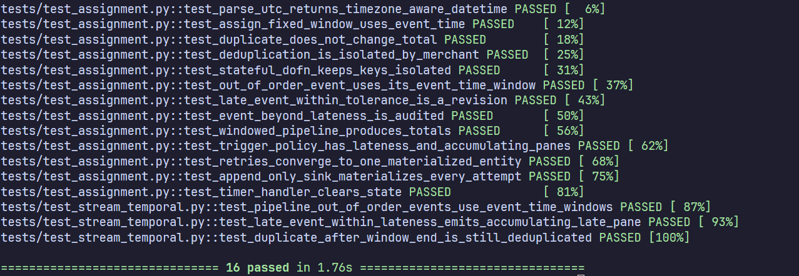

# Tarea 3 — Beam avanzado

Proyecto base autocontenido para la asignatura **Streaming de datos y sus
aplicaciones**. La tarea consiste en completar un pipeline de pagos con tiempo
de evento, ventanas, estado por clave y una salida idempotente.

Este repositorio contiene la **solución**: `notebook.py` tiene todas las
funciones implementadas y la suite de pruebas está completamente verde. La
explicación, las decisiones y la evidencia están al final.

## Objetivo

Producir totales confirmados por comercio y minuto:

- usando `event_time`, no el tiempo de llegada;
- tolerando hasta 120 segundos de atraso;
- descartando estados distintos de `CONFIRMED`;
- deduplicando `event_id` dentro de cada comercio;
- conservando metadatos de ventana y pane;
- materializando la salida mediante una clave idempotente.

## Ejecutar con Docker

Desde este directorio:

```bash
docker compose up --build notebook
```

Abrir <http://localhost:2718>. Docker inicia Marimo en modo editor porque la
tarea requiere completar las celdas de código. Los cambios en `notebook.py` se
guardan en el directorio local.

El editor usa `--no-token` para simplificar el trabajo en `localhost`; no debe
exponerse directamente a una red pública.

## Ejecutar con uv

```bash
uv sync --frozen
uv run marimo edit notebook.py
```

## Trabajar con tests

```bash
uv run pytest
```

La suite tiene 16 pruebas y todas pasan: las 13 provistas en
`tests/test_assignment.py` y 3 agregadas en `tests/test_stream_temporal.py`.

Los tests cargan las funciones directamente desde `notebook.py`; no hay que
copiar la solución a otro módulo.

Para validar además estilo y estructura:

```bash
uv run ruff check notebook.py
uv run marimo check --strict notebook.py
```

Dentro del contenedor también se puede ejecutar:

```bash
docker compose exec notebook uv run pytest
```

## Entrega

Entregar un repositorio propio que incluya:

- `notebook.py` con todas las funciones implementadas;
- evidencia de ejecución del pipeline;
- todas las pruebas provistas para desorden, duplicados, atraso y reintentos
  ejecutadas y aprobadas;
- un README breve con decisiones y trade-offs;
- instrucciones reproducibles con Docker o `uv`.

No modificar `data/payments.jsonl`; puede agregarse un conjunto de datos
adicional para las pruebas.

## Respuestas del marimo y este README

### Ventanas

Cada pago usa `event_time` como timestamp, no `arrival_time`. Las ventanas son
fijas de 60 s y se cuentan como `[inicio, fin)`. Un pago que llega desordenado
cae igual en la ventana de su `event_time`.

### Triggers

`build_trigger_policy` define tres momentos de emisión:

- **early**: una estimación cada 10 s de processing time, antes del cierre;
- **on-time**: cuando el watermark pasa el fin de la ventana;
- **late**: una revisión por cada pago tardío que llega dentro de los 120 s de
  lateness.

El modo es `ACCUMULATING`: cada pane trae el total completo de la ventana, no
solo la diferencia. Así el último pane siempre es el valor correcto.

### Estado y timer

`DeduplicatePayments` guarda los `event_id` ya vistos en un `SetState`. Beam
separa ese estado por clave (`merchant_id`) y por ventana, así que dos
comercios con el mismo `event_id` no se pisan.

Un timer de event time vence en `window.end + allowed_lateness` y borra el
conjunto. Sin ese timer el estado crecería para siempre, porque en un flujo
no acotado siempre llegan IDs nuevos. No se puede borrar antes, porque todavía
puede llegar un duplicado tardío.

### Idempotencia

La clave de escritura es `merchant_id|window_start`. Beam puede reintentar una
escritura (at-least-once), así que el sink hace un UPSERT sobre esa clave: el
segundo intento reemplaza la misma fila en lugar de agregar otra. Con 4
resultados y 2 intentos hay 8 filas de auditoría, pero solo 4 materializadas.
Un sink append-only (`POST`) materializaría 8.

### Decisiones y trade-offs

- **Oráculo en Python puro** (`summarize_payments`): aproxima el atraso con
  `arrival_time - event_time`. Es una simplificación didáctica; un watermark
  real es global al flujo, no por evento.
- **Más lateness = más completitud, más costo**: se aceptan más eventos
  tardíos, pero el estado vive más tiempo, los checkpoints pesan más y el
  sink recibe más revisiones.
- **Panes acumulativos + UPSERT**: la escritura es simple porque cada pane
  trae el total completo. Si los panes pudieran llegar desordenados al sink,
  habría que comparar `pane_index` para que uno viejo no pise uno nuevo.

### Pruebas agregadas

`tests/test_stream_temporal.py`:

| Prueba | Tipo | Qué demuestra |
|---|---|---|
| `test_pipeline_out_of_order_events_use_event_time_windows` | TestPipeline | Eventos desordenados caen en la ventana de su `event_time`; `PENDING` no suma |
| `test_late_event_within_lateness_emits_accumulating_late_pane` | TestStream | Un late aceptado genera un pane `ON_TIME` (100) y un pane `LATE` acumulado (150) |
| `test_duplicate_after_window_end_is_still_deduplicated` | TestStream | El timer vence en `window.end + lateness`: un duplicado que llega después del cierre se descarta |

Las pruebas de TestStream corren con `streaming=True`; sin esa opción
TestStream no respeta el watermark.


### Evidencia

```bash
uv run pytest -v
```



Resumen del notebook sobre `data/payments.jsonl` (lateness 120 s):

| Métrica | Valor |
|---|---:|
| Eventos leídos | 9 |
| Eventos aceptados | 5 |
| Totales por ventana | 4 |
| Monto confirmado | Gs. 540.000 |
| Intentos de escritura | 8 |
| Filas en el sink UPSERT | 4 |

Totales por comercio y ventana:

| Comercio | Ventana | Total |
|---|---|---:|
| m-azul | 13:00 | 170.000 |
| m-verde | 13:00 | 80.000 |
| m-verde | 13:01 | 90.000 |
| m-azul | 13:02 | 200.000 |


### Nota de compatibilidad

En Beam 2.74, `Duration` no tiene el atributo `.seconds`, que el test provisto
`test_trigger_policy_has_lateness_and_accumulating_panes` necesita leer.
`build_trigger_policy` agrega esa propiedad (`micros // 1_000_000`) antes de
construir la política. No cambia el comportamiento del pipeline.
